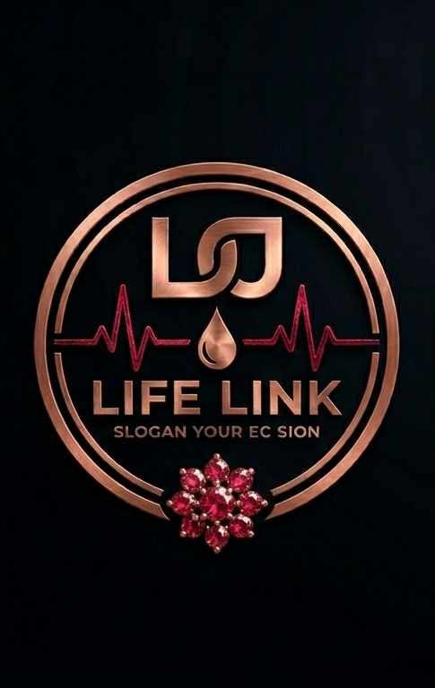

<p align="center">
  
</p>

<h1 align="center">LifeLink</h1>

<p align="center">
  <strong>Real-time emergency blood donor matching platform</strong><br/>
  Connecting hospitals that need blood <em>right now</em> with available, compatible donors — instantly.
</p>

<p align="center">
  
  
  
  
</p>

---

## About

LifeLink bridges the critical gap between hospital blood emergencies and volunteer donors. When a hospital posts an urgent blood request, compatible donors are alerted in real-time — no page refreshes, no phone calls, no delays.

**Key capabilities:**

- **Instant matching** — Supabase Realtime pushes alerts to donors the moment a request is posted
- **Smart compatibility** — Blood type matching goes beyond exact groups using medical compatibility rules
- **Role-based access** — Hospitals manage requests; donors receive and respond to alerts
- **Row-Level Security** — Every database query is enforced by PostgreSQL RLS policies
- **Dark / Light / System themes** — Full theme support with smooth transitions

---

## Tech Stack

| Layer | Technology | Version |
|-------|-----------|---------|
| **Frontend** | React (Create React App) | 18.2 |
| **Routing** | React Router DOM | 7.x |
| **Backend** | Supabase (PostgreSQL + Realtime + Auth) | 2.x client |
| **Icons** | Lucide React | 0.383 |
| **Styling** | Vanilla CSS design system (`index.css`) | — |
| **ORM** | Prisma (optional, for future backend services) | 5.17 |
| **Fonts** | Inter, Libre Baskerville (Google Fonts) | — |

---

## Architecture

```text
Landing Page  ──────────────────────────────────────────────
     │                                                      
     ├──▶  /donor    →  DonorDashboard  (open access)       
     │                                                      
     └──▶  /hospital →  Auth gate  →  HospitalDashboard     
                          │                                  
                     Email / Password                        
                     (Supabase Auth)                         
```

Both dashboards receive **real-time updates** via Supabase Realtime channels. The top navigation bar provides theme switching (light / dark / system), sign-out, and application reset.

---

## Project Structure

```text
lifelink/
├── public/
│   ├── index.html                 # HTML shell — Google Fonts, meta tags, CSS reset
│   └── LOGO.png                   # Application logo
├── src/
│   ├── index.js                   # React 18 entry point
│   ├── index.css                  # Full design system — themes, components, animations
│   ├── App.jsx                    # Router + top-nav layout + auth state management
│   ├── components/
│   │   ├── LandingPage.jsx        # Hero, "How it works", portal selection
│   │   ├── Auth.jsx               # Email/password sign-in and sign-up (split-screen)
│   │   ├── HospitalDashboard.jsx  # Create requests, manage donor responses
│   │   ├── DonorDashboard.jsx     # Receive alerts, respond, manage availability
│   │   ├── RoleSelector.jsx       # Role onboarding (legacy, kept for reference)
│   │   ├── VisualEnvironment.jsx  # Parallax background with 3D blood cell effect
│   │   ├── SupabaseDropdowns.jsx  # Example: donor/hospital data display
│   │   └── DebugDashboard.jsx     # Developer diagnostics panel
│   ├── hooks/
│   │   ├── useRequests.js         # Fetches blood requests + realtime sync
│   │   └── useDonors.js           # Fetches donors & hospitals + realtime sync
│   ├── lib/
│   │   ├── supabase.js            # Supabase client initialisation
│   │   ├── bloodLogic.js          # Blood type compatibility map & matching
│   │   └── supabaseDebug.js       # Connection testing utility
│   └── context/
│       └── ThemeContext.js         # Light / dark / system theme provider
├── prisma/
│   └── schema.prisma              # ORM schema (optional, future backend)
├── scripts/
│   └── setup.js                   # Automated project setup script
├── supabase_schema.sql            # Full database schema with RLS policies
├── .env.example                   # Environment variable template
├── package.json
└── .gitignore
```

---

## Quick Start

### Prerequisites

- [Node.js](https://nodejs.org/) 18+ and npm
- A [Supabase](https://supabase.com/) project (free tier works)

### 1. Clone and install

```bash
git clone https://github.com/1LifeLink1/LifeLink.git
cd LifeLink
npm install
```

### 2. Configure environment

Copy the template and fill in your Supabase credentials:

```bash
cp .env.example .env
```

```dotenv
# .env
REACT_APP_SUPABASE_URL=https://<your-project-id>.supabase.co
REACT_APP_SUPABASE_PUBLISHABLE_KEY=<your-anon-key>
```

> Find these values in your **Supabase Dashboard → Settings → API**.

### 3. Apply database schema

1. Open your Supabase project → **SQL Editor** → **New Query**
2. Paste the contents of `supabase_schema.sql`
3. Click **Run**

This creates all 5 tables, enables Row-Level Security, and configures Realtime.

### 4. Start the dev server

```bash
npm start
```

The app opens at [http://localhost:3000](http://localhost:3000).

---

## Environment Variables

| Variable | Description | Where to find |
|----------|-------------|---------------|
| `REACT_APP_SUPABASE_URL` | Your Supabase project URL | Dashboard → Settings → API → Project URL |
| `REACT_APP_SUPABASE_PUBLISHABLE_KEY` | Public anon key (safe to commit) | Dashboard → Settings → API → Anon / Public key |

> **Note:** The anon key is designed to be public. All sensitive operations are protected by Row-Level Security policies on the database.

---

## Database Schema

5 tables with full RLS coverage:

| Table | Purpose | Key columns |
|-------|---------|-------------|
| `profiles` | User role metadata | `user_id`, `role` (hospital \| donor), `display_name` |
| `donors` | Donor information | `user_id`, `name`, `blood_group`, `city`, `available` |
| `hospitals` | Hospital information | `user_id`, `name`, `city`, `contact_person` |
| `blood_requests` | Emergency blood requests | `hospital_id`, `blood_group`, `urgency`, `status` |
| `donor_responses` | Donor reactions to requests | `request_id`, `donor_id`, `status`, `eta_minutes` |

**9 RLS policies** enforce:

- Users can only manage their own records
- Hospitals manage their requests and view donor responses
- Authenticated users can read donor and hospital listings
- Donors can view requests assigned to them

See [`supabase_schema.sql`](supabase_schema.sql) for the complete schema.

---

## Authentication

LifeLink uses **Supabase email/password authentication**.

| Flow | Description |
|------|-------------|
| **Sign Up** | Enter email + password → confirm via email → sign in |
| **Sign In** | Email + password → redirected to Hospital Dashboard |
| **Donor access** | No authentication required — register directly from the Donor portal |
| **Hospital access** | Requires authenticated sign-in through the Facility Portal |

### Supabase Auth Configuration

1. Go to **Authentication → Providers → Email**
2. Ensure **Enable Email Auth** is ON
3. Set **Confirm email** as needed (ON for production, OFF for local testing)

---

## Real-time Demo

Open the app in **two browser tabs** side by side:

| Tab 1 — Hospital | Tab 2 — Donor |
|---|---|
| Sign in with hospital credentials | Navigate to `/donor` and register |
| Click **New Request** → select blood group → post | Alert appears **instantly** for matching donors |
| — | Click **I can donate** |
| Request status updates to "In progress" | Confirmation banner shows |

No page refresh required — Supabase Realtime pushes all changes via WebSocket.

---

## Blood Compatibility

LifeLink uses medical blood type compatibility rules (not just exact matching):

| Recipient | Compatible Donor Groups |
|-----------|------------------------|
| A+ | A+, A−, O+, O− |
| A− | A−, O− |
| B+ | B+, B−, O+, O− |
| B− | B−, O− |
| AB+ | All groups (universal recipient) |
| AB− | AB−, A−, B−, O− |
| O+ | O+, O− |
| O− | O− only (universal donor) |

---

## Roadmap

| Feature | Status |
|---------|--------|
| Email/password authentication | ✅ Done |
| Role-based access (Hospital / Donor) | ✅ Done |
| Real-time sync via Supabase Realtime | ✅ Done |
| Blood compatibility matching | ✅ Done |
| Dark / light / system themes | ✅ Done |
| Landing page with portal selection | ✅ Done |
| Router-based navigation | ✅ Done |
| SMS alerts (Twilio) | ⏳ Planned |
| Push notifications (Web Push API) | ⏳ Planned |
| Maps with hospital locations (Mapbox) | ⏳ Planned |
| Deploy to Vercel | ⏳ Ready |

---

## Documentation

| Document | Purpose |
|----------|---------|
| [SUPABASE_SETUP_GUIDE.md](SUPABASE_SETUP_GUIDE.md) | Step-by-step Supabase configuration |
| [TROUBLESHOOTING.md](TROUBLESHOOTING.md) | Common issues and fixes |
| [CONTRIBUTING.md](CONTRIBUTING.md) | Developer workflow and guidelines |

---

## Contributing

See [CONTRIBUTING.md](CONTRIBUTING.md) for development workflow, coding guidelines, and how to document changes.

---

## Resources

- [Supabase Documentation](https://supabase.com/docs)
- [React Documentation](https://react.dev)
- [Lucide Icons](https://lucide.dev)
- [GitHub Repository](https://github.com/1LifeLink1/LifeLink)

---

<p align="center">
  <sub>Built with a security-first approach. Row-Level Security policies ensure proper data isolation.<br/>For production, add rate-limiting and audit logging.</sub>
</p>
